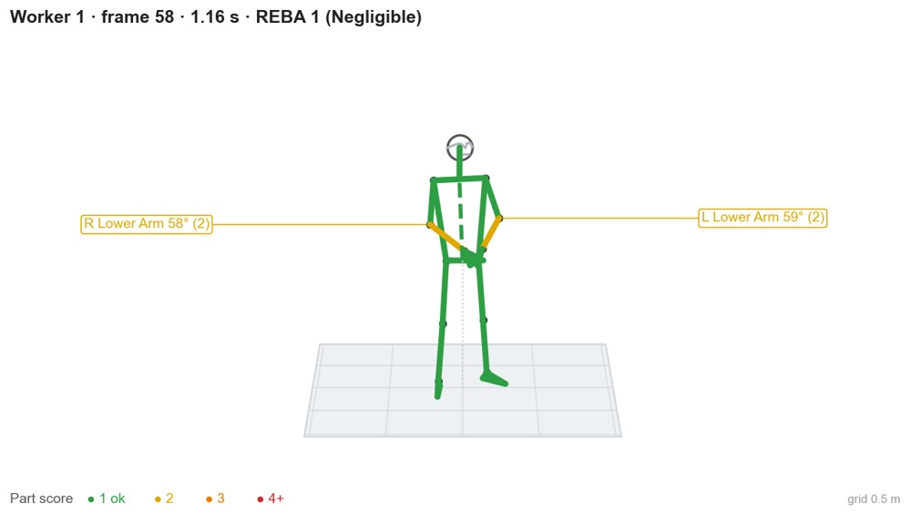
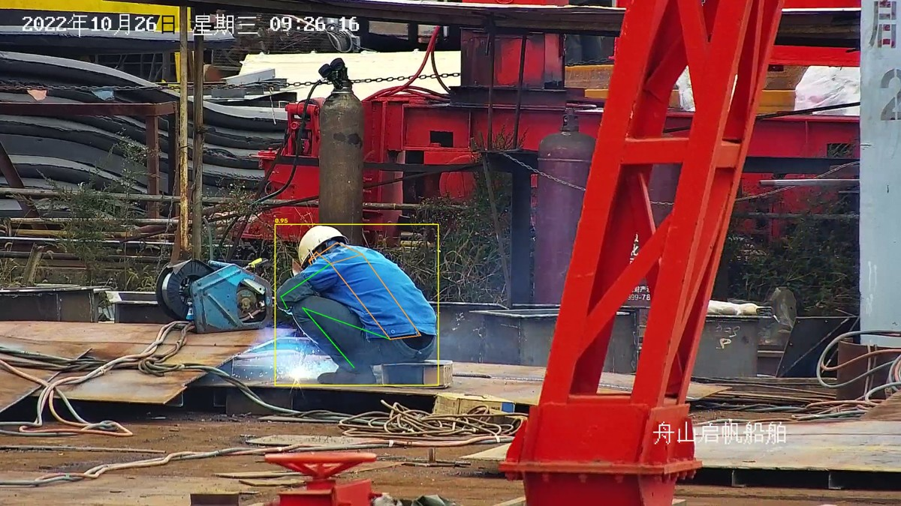
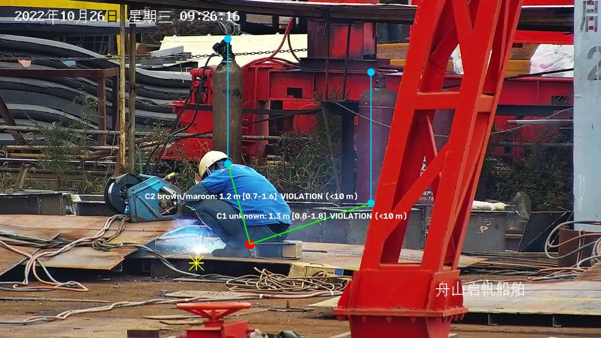
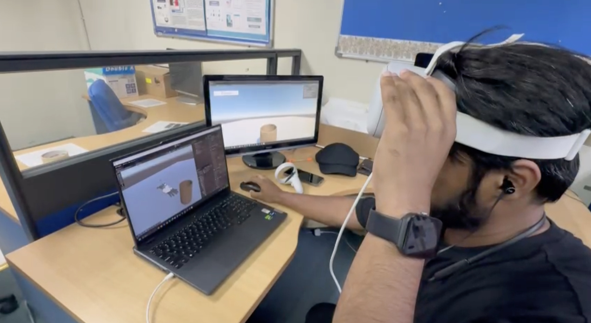
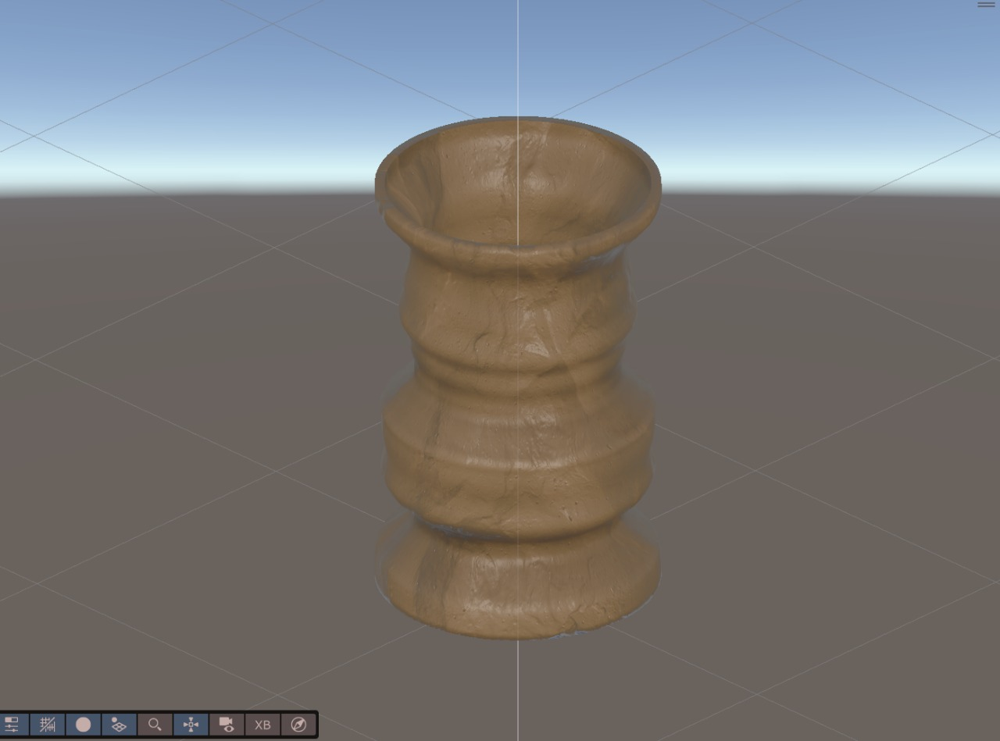

# Hi, I'm Sufril! 👋

**Associate Professor Dr. Ahmad Sufril Azlan bin Mohamed**

**Associate Professor · AI & Computer Vision Researcher · Applied AI Developer**  
School of Computer Sciences, **Universiti Sains Malaysia (USM)**

I build and evaluate intelligent visual systems, connecting **academic research** with **real-world AI applications**. My work spans computer vision, deep learning, human movement analysis, medical imaging, edge AI, and immersive learning. I also preserve documented research prototypes and historical implementations to support continued study and collaboration.

[**Explore the 29-repository directory →**](showcase/research-portfolio.md)

## 🎓 Academic background

I am an Associate Professor at the School of Computer Sciences, Universiti Sains Malaysia, Penang, Malaysia. My research brings together image processing, visual tracking, medical and thermal imaging, and intelligent interactive systems.

- **PhD, Image Processing / Computer Vision** — University of Salford, United Kingdom
- **MSc, Computer Science** — University of Manchester, United Kingdom
- **Bachelor of Information Technology (Hons), Multimedia Technology** — Multimedia University, Malaysia

Qualifications and research background: [USM Experts CV](https://experts.usm.my/cvitae/sufril).

### 🔬 Areas of interest

`Computer Vision` · `Image Processing` · `Deep Learning` · `Object Detection & Tracking` · `Defect Detection` · `Object Recognition` · `Near-Miss Analysis` · `Markerless Motion Capture` · `Medical & Thermal Imaging` · `VR/AR/XR` · `Game Development` · `Edge AI`

## 📚 Research profile

My Google Scholar research interests include **defect detection, object recognition, near-miss analysis, markerless motion capture, and virtual reality**. These complement my USM research interests in image processing, video tracking, medical and thermal imaging, AI, deep learning, and immersive technologies.

### Google Scholar metrics

| Metric | All time | Since 2021 |
| --- | ---: | ---: |
| Citations | 1,707 | 1,597 |
| h-index | 22 | 20 |
| i10-index | 44 | 41 |

*Snapshot checked on 21 October 2026. Metrics change over time; see [Google Scholar](https://scholar.google.com/citations?hl=en&user=AHj1bTgAAAAJ) for current figures.*

### Selected publications

- **Improved genetic algorithm for mobile robot path planning in static environments** — *Expert Systems with Applications* 249, 123762 (2024).
- **Efficientnet-lite and hybrid CNN-KNN implementation for facial expression recognition on raspberry pi** — *IEEE Access* 9, 134065–134080 (2021).
- **Implementation of kinetic and kinematic variables in ergonomic risk assessment using motion capture simulation: A review** — *International Journal of Environmental Research and Public Health* 18(16), 8342 (2021).
- **Gaussian-based R-CNN with large selective kernel for rotated object detection in remote sensing images** — *Neurocomputing* 620, 129248 (2025).
- **YOLOv7-SiamFF: Industrial defect detection algorithm based on improved YOLOv7** — *Computers and Electrical Engineering* 114, 109090 (2024).

Publication details and the full list are available on [Google Scholar](https://scholar.google.com/citations?hl=en&user=AHj1bTgAAAAJ).

## Research papers and reusable resources

[**Explore five research pages →**](research/README.md)

Read the publications, find citation files and see how each study relates to the available project resources: [ErgoMotion](research/ergomotion/README.md), [2D human pose](research/human-pose/README.md), [PCB inspection](research/pcb-inspection/README.md), [near-miss analysis](research/near-miss/README.md) and [3D medical imaging](research/medical-reconstruction/README.md).

## 🚀 Featured project gallery

These four projects illustrate my work in AI-powered visual analytics, human-centred intelligent systems, and immersive technologies. The gallery features actual project analysis renders, annotated images, and SayongVR demonstration visuals. Analysis overlays show research outputs and require human interpretation. Each link opens a project walkthrough.

### 🧍 ErgoMotion — AI-assisted ergonomic assessment

Desktop video analysis with single-camera worker tracking or calibrated multi-camera 3D reconstruction, joint-angle visualisation, and REBA scoring. Frame-by-frame review, task-context inputs, timelines, and exports support research-oriented ergonomic assessment.

**[Explore ErgoMotion: workflow, technology & limitations →](showcase/ergomotion.md)**

### 📐 Human Pose Analytics — explainable posture analysis

Batch CCTV analysis with tiled person detection, 17-point pose estimation, explainable posture rules, and helmet checks. Annotated media, structured data, and a results viewer support human review and label correction.

**[Explore Human Pose Analytics: methods, outputs & evaluation →](showcase/human-pose.md)**

### 🦺 AI Site Safety — visual inspection assistance

Tool-connected visual review of worker posture, helmet use, hot work, and gas cylinders. Remote and local deployment options produce annotated images and structured findings; single-image distances and safety flags require independent verification.

**[Explore AI Site Safety: tools, deployment & review workflow →](showcase/site-safety.md)**

### 🏺 SayongVR — virtual pottery & interactive 3D modelling

An immersive Labu Sayong experience combining virtual pottery, hand tracking, and interactive 3D modelling.

**MyIPO patent application PI 2026005263 — “Slice-Based Volumetric Modelling with Localized Deformation” (patent filed).**

**[Explore SayongVR and its 3D modelling approach →](showcase/sayongvr.md)**

## 🧪 Research and project directory

[**Explore the documented research portfolio →**](showcase/research-portfolio.md)

As of **21 October 2026**, this account contains **29 repositories: this public profile and 28 private repositories** covering applications, research archives, educational tools, data and AI infrastructure. All are listed below. Private links require existing access; these summaries do not publish their source or data.

| Project | Focus | Current scope |
| --- | --- | --- |
| [ErgoMotion Desktop](showcase/research-portfolio.md#ergomotion) | Motion analysis | Desktop application |
| [ErgoMotion Web](showcase/research-portfolio.md#ergomotion-web) | Motion analysis | Browser prototype |
| [Human Pose Analytics](showcase/research-portfolio.md#human-pose) | Site safety | Research baseline |
| [Cylinder–Hot-Work Distance](showcase/research-portfolio.md#cylinder-distance) | Site safety | Measurement prototype |
| [Safety Detector](showcase/research-portfolio.md#safety-detector) | Site safety | Mac desktop application |
| [Site Safety Harness Plugin](showcase/research-portfolio.md#dsh-site-safety) | Site safety | Tool integration |
| [Site Safety on Mac](showcase/research-portfolio.md#site-safety-mac) | Site safety | Apple silicon deployment |
| [Gas Safety Detection](showcase/research-portfolio.md#kimi-gas-safety) | Site safety | Detection experiment |
| [Site Safety Data](showcase/research-portfolio.md#site-safety-data) | Supporting data | Private dataset |
| [Local Harness Workspace](showcase/research-portfolio.md#dsh-local) | AI infrastructure | Deployment support |
| [Small Agent Harness](showcase/research-portfolio.md#small-harness) | AI infrastructure | Agent prototype |
| [CS@USM Bloom’s Taxonomy Indicator](showcase/research-portfolio.md#taxonomy) | Educational AI | Browser prototype |
| [USM Handbook AI Assistant](showcase/research-portfolio.md#usm-handbook-ai-assistant) | Educational AI | Student-support prototype |
| [3DMRIRendering](showcase/research-portfolio.md#mri-reconstruction) | MRI/CT reconstruction and mesh visualization | Research application |
| [ErgoMotion VR](showcase/research-portfolio.md#ergomotion-vr) | Immersive ergonomic posture assessment | Unity prototype |
| [MATLAB Image Stitching](showcase/research-portfolio.md#matlab-image-stitching) | Image alignment for machine-vision inspection | Archival algorithm |
| [C++ Stitching Launcher](showcase/research-portfolio.md#cpp-stitching-launcher) | MATLAB-to-C++ integration | Integration wrapper |
| [METAL Motion Analysis](showcase/research-portfolio.md#metal-motion-analysis) | Markerless joint and movement analysis | Research prototype |
| [WAHSP Vehicle Interface](showcase/research-portfolio.md#wahsp-system) | Vehicle cameras, HUD and sensor warnings | Unity simulation scripts |
| [Near-Miss Detection](showcase/research-portfolio.md#near-miss-detection) | Traffic tracking and proximity analysis | Research and training |
| [CEED Ceramic Education](showcase/research-portfolio.md#ceed-ceramic-simulation) | Ceramics instruction, 3D content and quizzes | Browser learning materials |
| [RUTEAM Container Monitoring](showcase/research-portfolio.md#ruteam-container-monitoring) | Container OCR, PPE and edge monitoring | Edge-vision prototype |
| [DARVIH](showcase/research-portfolio.md#darvih) | Game-based drug-prevention education | Unity educational-game scripts |
| [PCB AOI and OCR](showcase/research-portfolio.md#pcb-aoi-ocr) | PCB annotation and crop preparation | Source fragment |
| [Ultrasound Tendon Tracking](showcase/research-portfolio.md#ultrasound-tendon-tracking) | Ultrasound tracking and algorithm studies | Historical PhD archive |
| [FAIRS Face Recognition](showcase/research-portfolio.md#fairs-face-recognition) | Face identification and verification | Historical MSc archive |
| [Legacy ErgoMotion Python](showcase/research-portfolio.md#ergomotion-legacy-python) | Earlier desktop motion-analysis source | Earlier implementation |
| [FloWave.US Reference Archive](showcase/research-portfolio.md#blood-flow-analysis) | Attributed FloWave.US ultrasound software | Third-party MIT software |
| [DrSufril Profile](showcase/research-portfolio.md#drsufril) | Academic profile and complete repository directory | Public profile |

The existing featured gallery above provides selected project walkthroughs. The directory adds context and links for the broader research collection.

## 🛠️ Tools & technologies

**AI / Computer Vision:** `Python` · `PyTorch` · `YOLO` · `OpenCV` · `MediaPipe` · `CUDA`  
**Scientific Computing:** `MATLAB` · `C++` · `Qt` · `CUDA` 
**Immersive Computing:** `Unity` · `C#` · `VR/AR/XR`  
**Systems & Workflow:** `Raspberry Pi` · `Git` · `Edge AI`

## 🤝 Research & collaboration

I'm interested in collaborative research, student development, and industry R&D involving **AI, computer vision, intelligent monitoring, human motion analysis, medical imaging, and immersive computing**.

- 📚 [Google Scholar](https://scholar.google.com/citations?user=AHj1bTgAAAAJ)
- 🎓 [USM Experts CV](https://experts.usm.my/cvitae/sufril)
- 🏫 [USM faculty profile](https://cs.usm.my/index.php/faculty-member/164-ahmad-sufril-azlan-mohamed-dr)
- 🆔 [ORCID: 0000-0002-2838-0872](https://orcid.org/0000-0002-2838-0872)
- 📖 [Scopus author profile](https://www.scopus.com/authid/detail.uri?authorId=57190968285)
- 🔎 [Web of Science: O-7036-2015](https://www.webofscience.com/wos/author/record/O-7036-2015/)
- ✉️ [sufril@usm.my](mailto:sufril@usm.my)

*Research prototypes and archived implementations have different levels of completeness. Private project links require existing access; source code, datasets and additional media remain subject to their contributors’ sharing terms.*

---

**Bridging academic research and practical intelligent systems.**
