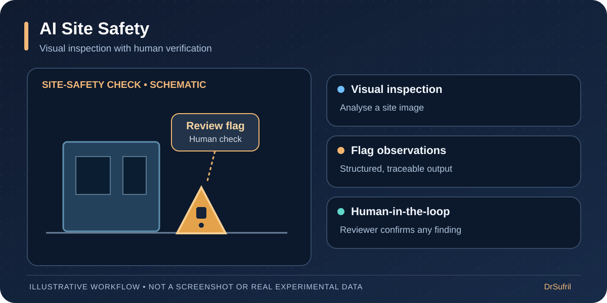

# Hi, I'm Sufril! 👋

**Associate Professor · AI & Computer Vision Researcher · Applied AI Developer**  
School of Computer Sciences, **Universiti Sains Malaysia (USM)**

I build and evaluate intelligent visual systems, connecting **academic research** with **real-world AI applications**. My work spans computer vision, deep learning, human movement analysis, medical imaging, and immersive technologies.

### 🔬 Areas of interest

`Computer Vision` · `Deep Learning` · `Object Detection & Tracking` · `Human Pose Estimation` · `Medical Imaging` · `VR/XR` · `Edge AI`

## 🚀 Featured project gallery

These four projects illustrate my work in AI-powered visual analytics, human-centred intelligent systems, and immersive technologies. The ErgoMotion, Human Pose Analytics, and AI Site Safety previews are conceptual illustrations. SayongVR features a project demonstration photo and a 3D model screenshot. Each link opens a project walkthrough.

### 🧍 ErgoMotion — AI-assisted ergonomic assessment

Desktop video analysis with single-camera worker tracking or calibrated multi-camera 3D reconstruction, joint-angle visualisation, and REBA scoring. Frame-by-frame review, task-context inputs, timelines, and exports support research-oriented ergonomic assessment.

**[Explore ErgoMotion: workflow, technology & limitations →](showcase/ergomotion.md)**

### 📐 Human Pose Analytics — explainable posture analysis

Batch CCTV analysis with tiled person detection, 17-point pose estimation, explainable posture rules, and helmet checks. Annotated media, structured data, and a results viewer support human review and label correction.

**[Explore Human Pose Analytics: methods, outputs & evaluation →](showcase/human-pose.md)**

### 🦺 AI Site Safety — visual inspection assistance

Tool-connected visual review of worker posture, helmet use, hot work, and gas cylinders. Remote and local deployment options produce annotated images and structured findings; single-image distances and safety flags require independent verification.

**[Explore AI Site Safety: tools, deployment & review workflow →](showcase/site-safety.md)**

### 🏺 SayongVR — virtual pottery & interactive 3D modelling

An immersive Labu Sayong experience combining virtual pottery, hand tracking, and interactive 3D modelling.

**MyIPO patent application PI 2026005263 — “Slice-Based Volumetric Modelling with Localized Deformation” (patent filed).**

**[Explore SayongVR and its 3D modelling approach →](showcase/sayongvr.md)**

## 🧪 Additional research directions

| Project / research area | Overview |
| --- | --- |
| **UAV Container Monitoring** | Drone imagery for container detection, tracking, identification, and OCR-assisted monitoring; research includes planning field data collection and coordinating visual-analysis requirements. |
| **Medical Imaging & Spine Analysis** | Research into image-based tracking and quantitative movement analysis, with a focus on medical imaging and spine-related motion. |

## 🛠️ Tools & technologies

**AI / Computer Vision:** `Python` · `PyTorch` · `YOLO` · `OpenCV` · `MediaPipe` · `CUDA`  
**Immersive Computing:** `Unity` · `C#` · `VR/AR/XR`  
**Systems & Workflow:** `Raspberry Pi` · `Git` · `Edge AI`

## 🤝 Research & collaboration

I'm interested in collaborative research, student development, and industry R&D involving **AI, computer vision, intelligent monitoring, human motion analysis, medical imaging, and immersive computing**.

- 📚 [Google Scholar](https://scholar.google.com/citations?user=AHj1bTgAAAAJ)
- 🎓 [Universiti Sains Malaysia](https://www.usm.my/)

*Some projects are active research or private industrial collaborations. Public repositories, demonstrations, and datasets will be linked only where release and sharing are authorised.*

---

**Bridging academic research and practical intelligent systems.**
