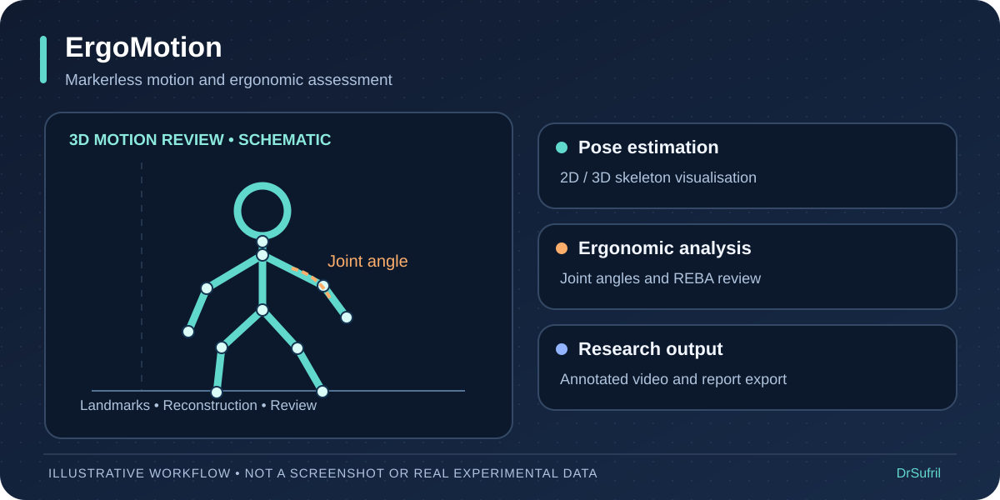
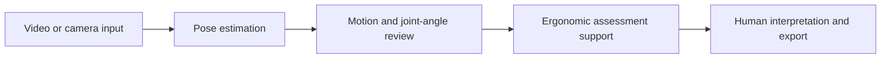

# ErgoMotion — workflow preview

[← Back to DrSufril's profile](../README.md)

> **Illustrative workflow:** A conceptual walkthrough of a markerless ergonomic assessment workflow. This page is not a recording or a screenshot of the private application.

## A short, step-by-step demonstration

1. **Input:** A recorded video or camera feed is selected for review.
2. **Pose analysis:** Body landmarks are estimated and visualised over the scene.
3. **Motion review:** Where supported, 3D reconstruction and joint-angle analysis help interpret body movement.
4. **Ergonomic interpretation:** REBA-related observations are reviewed with appropriate human context.
5. **Output:** Reviewable visualisations and reports can be exported for research analysis.

## Simplified workflow

## Important limitations

The illustration contains no participant footage. Automated ergonomic scores depend on input quality, calibration, and manually supplied context; they are not substitutes for a professional ergonomic assessment.

**Source availability:** Underlying project repositories, datasets, and internal system screenshots remain private unless separately approved for release.
