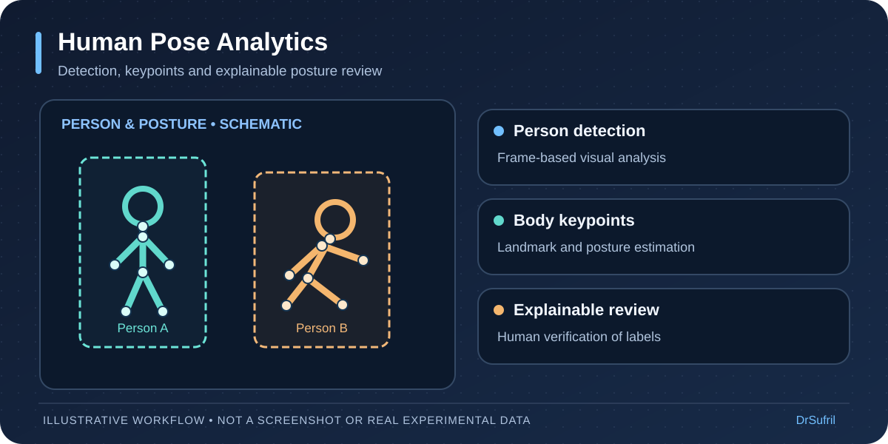

# Human Pose Analytics — workflow preview

[← Back to DrSufril's profile](../README.md)

> **Illustrative workflow:** An illustrative walkthrough of a human-pose analysis research pipeline, based on a high-level description of the existing project. It is not a live demonstration or a screenshot.

## A short, step-by-step demonstration

1. **Input:** Still images or video frames are selected for analysis.
2. **Person detection:** The system identifies candidate people in each frame.
3. **Pose estimation:** Body keypoints are estimated for each detected person.
4. **Posture review:** Interpretable rules produce preliminary posture categories.
5. **Human verification:** A reviewer can inspect, correct, and interpret outputs.

## Simplified workflow

## Important limitations

Posture classifications are research-stage outputs that can fail on occluded, crowded, or unseen scenes. They should not be used alone to decide whether a workplace is safe.

**Source availability:** Underlying project repositories, datasets, and internal system screenshots remain private unless separately approved for release.
