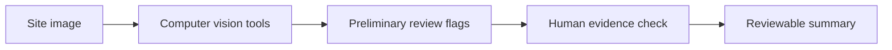

# AI Site Safety — workflow preview

[← Back to DrSufril's profile](../README.md)

> **Illustrative workflow:** A conceptual illustration of how AI-assisted visual site review can help a human investigator. It does not display industrial footage or private tool interfaces.

## A short, step-by-step demonstration

1. **Input:** A site image is supplied to a visual inspection workflow.
2. **Analysis:** Computer vision tools examine relevant visible elements.
3. **Observations:** The workflow records structured findings and potential review flags.
4. **Evidence review:** A human checks the original image and evaluates uncertainties.
5. **Output:** A reviewable summary supports further inspection, without claiming safety certification.

## Simplified workflow

## Important limitations

Single-image analysis has substantial uncertainty. Any distance estimate, hazard assessment, or safety judgement requires appropriate independent validation and human oversight.

**Source availability:** Underlying project repositories, datasets, and internal system screenshots remain private unless separately approved for release.
